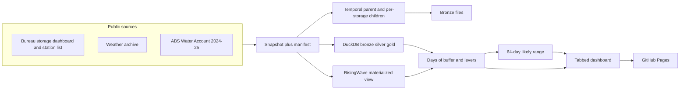

# Dry summer water watch

Which Australian water supplies are already under a low-storage line this El Niño summer, how many days of buffer the others have if it stays dry, and whether restrictions, desalination or recycled water closes the gap.

A strong El Niño and a positive Indian Ocean Dipole are underway. The practical question for water ministers, utilities and councils, before Christmas, is where the stored water is already thin and which lever can actually fill that hole.

This project answers that from public readings only. Daily storage volumes come from the Bureau of Meteorology. Rain and evaporation at the gauges come from a public weather archive. Household use, desalination and recycled water come from the Australian Bureau of Statistics Water Account 2024–25. Dry, typical and wet paths replay each storage’s own recent summers. They are scenarios, not a promise of the season.

**This is a briefing, not a restriction order.** The 40% line used here is a planning line for this page, not a legal trigger for any one utility.

[](https://github.com/LuciferDataEngineer/dry-summer-water-watch/actions/workflows/ci.yml)
[](https://github.com/LuciferDataEngineer/dry-summer-water-watch/actions/workflows/pages.yml)
[](LICENSE)

Live dashboard: [https://luciferdataengineer.github.io/dry-summer-water-watch/](https://luciferdataengineer.github.io/dry-summer-water-watch/)

Figures below are from the snapshot taken **15 November 2026, 9:27 am AEDT**. Storage readings used in the counts are current to **14 November 2026**.

## Headline result

**South Dandalup, a Perth supply, is 9.1% full** (11,408 ML of 125,060 ML). It is the town supply already under the 40% line. On its driest recent summer it would be empty by the end of March. A middle summer leaves it around 3% full. Even its wettest recent summer leaves it around 6%.

Eight tracked supplies are already under 40% of accessible capacity. None of the others would newly cross 40% before Christmas if they repeated their driest recent summer. The supplies in trouble are already there.

| | Now | What a dry summer does |
| --- | ---: | --- |
| South Dandalup (Perth) | **9.1%** | Empty by the end of March |
| Serpentine (Perth) | **31.6%** | About 17% by the end of March |
| Mundaring (Perth) | **34.7%** | About 13% by the end of March |
| Perth, whole system | **38.5%** | 7.6 points down on last year (was 46.1%) |
| Lake Menindee (NSW gauge) | **0%** | Empty on this gauge since 10 January 2026 |
| Sydney, whole system | **92.1%** | 5.1 points down on last year, still high |
| Warragamba | **93.8%** | Still about 90% at the end of a dry summer |

The state total hides the city. Western Australia as a whole is **86.2%** full, up 5.5 points on last year, because large northern storages are healthy. The South West Coast drainage division, which is the Perth side, is **39.3%** full, down from 48.7% last year. South East Coast (Victoria) is **44.9%**.

New South Wales storages together are **57.7%**, down 6.7 points on last year (was 64.4%). The Murray–Darling Basin on the Bureau’s own rollup is **68.2%**, 1.3 points higher than last year. That is the whole basin, not the northern part on its own.

Farming storages are a different problem from town supplies. On a dry-summer pace, tracked NSW farming storages would finish March **1,160 billion litres** under the 40% line. Burrendong (32% now) would run dry. Keepit (53% now) is the first farming storage that would newly cross 40%, in about **43 days**, just after Christmas. Blowering would fall from 63% to about 28% by the end of March.

**What closes the Perth gap.** The tracked town supplies in Western Australia would be **98 billion litres** short of the 40% line by 31 March if they repeated their driest recent summer. Scaled to the days left in the water year:

| What-if, using last year’s actual supply | Volume | Share of the 98 billion litre gap |
| --- | ---: | ---: |
| Desalination at the 2024–25 pace | 53 billion litres | **54%** |
| Households use 15% less than last year | 16 billion litres | **16%** |
| Recycled water at the 2024–25 pace | 14 billion litres | **14%** |

Those three are different supplies, so they can be added. Together they cover about **84%** of that town-supply gap. They do not touch the NSW farming gap: last year’s NSW desalination, scaled to the rest of summer, is about 8 billion litres, against a farming gap of 1,160.

Nationally, in 2024–25, households used **1,920 billion litres**, desalination supplied **199 billion litres** (up from 170), and recycled water supplied **323 billion litres**.

A likely range for the next 64 days, from an open time-series model run on CPU, missed the last 60 days by **3.4% of capacity** on average. The same date last year missed by **19.3%**. Carrying forward the last month missed by **6.5%**. The model’s middle path was closer than last year on **22 of 24** storages, and closer than the last month on **17 of 24**.

Detail and method notes are in [INSIGHTS.md](INSIGHTS.md). The dashboard states the same findings without the method names.

## Architecture



CI rebuilds the gold tables and the site from the committed snapshot. It does not call the live sources. A separate workflow can refresh the snapshot and upload it as an artifact. Promoting a new snapshot is a deliberate commit.

## Tech stack

| Piece | Why it is here |
| --- | --- |
| Temporal Python SDK and `temporal server start-dev` | The ingest is a parent workflow with one child workflow per storage. Activities retry with backoff, heartbeat, and write each slice so a second attempt is a no-op. An integration test kills the worker and shows the workflow finishes on a new worker. |
| RisingWave single node | Daily readings are replayed as a stream. A materialized view keeps the 30-day and 90-day change, a status band, and the days to the 40% line. The same SQL is timed as a full rebuild in DuckDB. |
| KEDA on kind, Temporal scaler | The worker deployment scales from 1 to 3 when the `water-ingest` task queue backs up, then back to 1. The CI job waits on the deployment’s ready replica count. |
| Chronos-Bolt small | An open, Apache-2.0 time-series model produces a 10th-to-90th percentile band for 64 days on CPU. The last 60 days are held out and scored against a same-date-last-year path and a last-month pace. |
| DuckDB | Bronze, silver and gold tables, including the batch form of the drawdown query. No Postgres and no hosted database. |
| Polars | The same state counts are computed beside DuckDB, and the build stops if the two engines disagree. |
| Pure SQL checks | Eleven row, range, duplicate and coverage checks against the gold database. |
| pytest and ruff | Unit tests for the summer paths, the gap arithmetic, and the wording on the built pages. |
| Dockerfile and Compose | One image rebuilds the site from the snapshot. Compose starts a Temporal dev server and RisingWave for local runs. |
| GitHub Pages | Static tabbed dashboard. No tile server. The map is an SVG drawn at build time. |

## What's new vs the previous project

Project 15, bushfire-fleet-planner, placed six large air tankers with Sedona on Spark, DuckDB spatial, a Ray season simulation on KubeRay, OR-Tools, Argo CD and OPA policy checks. Earlier projects in the series used dbt, Dagster, Kafka, Debezium, Spark streaming, Delta, Iceberg, Trino, ClickHouse, Flink, Airflow, Feast, MLflow, Evidently, PyMC, OpenLineage, Great Expectations, Pandera, Terraform, Helm, lakeFS, SQLMesh, Argo Workflows and OpenTelemetry.

This project moves from “where should the aircraft sit” to “which supply runs short, and which lever closes it”, and adds five things project 15 did not have:

- Temporal durable workflows, with child workflows per storage, activity retries, heartbeats, idempotent writes, and a tested resume after the worker is killed.
- RisingWave streaming SQL, with an incremental materialized view for drawdown, status and days-to-line, exported beside the DuckDB gold tables.
- KEDA on kind, scaling the Temporal worker from the task-queue backlog and proving the scale-out and scale-in from the deployment status.
- An open time-series foundation model (Chronos-Bolt small) for a 64-day likely range, scored against two simple paths.
- A timed comparison of the RisingWave refresh and a full DuckDB rebuild of the same drawdown query, on a free runner.

## Data sources

All of these are free and openly licensed. Nothing in the snapshot was invented. The snapshot was taken with a browser-like client over HTTPS.

| Publisher | What | URL | Licence | Coverage in this snapshot | Accessed |
| --- | --- | --- | --- | --- | --- |
| Bureau of Meteorology | Water storage dashboard, latest site table, state and drainage rollups, capital-city cards, daily accessible volume | https://www.bom.gov.au/water/dashboards/rest.php | CC BY 4.0 | 306 storages with a capacity and a percent full. Daily history for 64 large, low or priority supplies from 1 January 2022 (113,279 rows). State, drainage and eight capital-city cards. | 15 Nov 2026, 9:27 am AEDT |
| Bureau of Meteorology | KiWIS station list, storage volume sites, for gauge coordinates | https://www.bom.gov.au/waterdata/services | CC BY 4.0 | Name match onto the dashboard storages. 46 of 64 tracked supplies matched a gauge inside Australia. The other 18 stay in the tables and off the map. | same |
| Open-Meteo | Archive daily rain, temperature and FAO reference evapotranspiration | https://archive-api.open-meteo.com/v1/archive | CC BY 4.0 | 81,834 rows at the matched gauges, 1 Jan 2022–14 Nov 2026, dated on Australian Eastern time. | same |
| Australian Bureau of Statistics | Water Account, Australia, 2024–25, Table 13 physical supply and use | https://www.abs.gov.au/statistics/environment/environmental-accounts/water-account-australia/2024-25/WAADC13_.csv | CC BY 4.0 | Household use, utility desalination and total reuse, Australia and states, 2014–15 to 2024–25. | same |
| Natural Earth, via the martynafford GeoJSON mirror | 1:50m admin-1 states, Australia only | https://github.com/martynafford/natural-earth-geojson | Public domain | State outlines for the map. Coordinates rounded to 0.01 degree. The 1:110m file on the public mirrors currently contains only the United States, so it was not used. | same |

Hashes, byte sizes and row counts are in [`data/snapshot/manifest.json`](data/snapshot/manifest.json).

### What was checked and did not go into the snapshot

The Murray–Darling Basin Authority publishes a fortnightly water-in-storage report. This snapshot uses the Bureau’s drainage rollup for the basin instead. On 15 November 2026 that rollup says the basin is 68.2% full. A separate northern-basin figure of about 52% is context from the Bureau’s long-range commentary, not a number this pipeline computed, and it is not on the dashboard.

Hume is published under both New South Wales and Victoria, with the same capacity. The pages keep one copy so the gap is not counted twice.

### The 40% line and the paths

These are choices, stated here so the page can stay in plain language.

| Choice | Value |
| --- | --- |
| Low line | 40% of accessible capacity |
| Watch | Under 60%, or a dry path that crosses 40% before 31 March 2027 |
| Critical colour | Under 25% |
| Dry path | The completed summer (1 Nov–31 Mar, 2022–23 through 2025–26) with the lowest average daily change. A summer counts only with at least 40 days. |
| Typical / wet | The middle and the highest of those summer averages |
| Last month | The average daily change over the 30 days up to the latest reading |
| Holds | Not falling by at least 1 ML a day, so it is not on a path toward the line |
| Household what-if | 15% less than last year’s household use, scaled by the days left until 31 March 2027 |
| Desalination and recycled water | Last year’s annual supply, scaled by the same days |
| Likely range | Chronos-Bolt small, next 64 days, 10th to 90th percentile. The summer lines are not from this model. |
| Town / farming / power-station | A name rule, so a city’s desalination plant is not asked to refill Hume. Power-station lakes are drawn but left out of the “already under 40%” count. |

## Cleaning and transformation

1. Keep dashboard storages with a positive accessible capacity and a percent full. Parse thousands separators. A nil ABS cell (`-`) is zero. A suppressed cell (`np`, `na`, `..`) stays blank.
2. Tag each storage town, farming, power-station or regional from its name. The rule is in the code and listed above.
3. Keep a daily history for supplies that are large (at least 80,000 ML), already under 50% and at least 15,000 ML, or on a priority list of urban and regional names. Cap the list at 64. This snapshot has 63 after the Hume duplicate is folded on the pages, and 64 in the gold table before that fold.
4. Drop blank daily volumes. If two readings share a day, keep the larger. Spread a gap evenly across the missing days when measuring the summer pace.
5. Match a Bureau gauge by name for the map. Reject coordinates outside Australia. If two gauges tie, leave the storage off the map.
6. DuckDB builds silver tables and the 30-day and 90-day change. Polars counts the same rows by state. Eleven SQL checks then run.
7. The summer paths, the days of buffer, the state levers and the pages are computed from those tables. The likely range is read from the committed model output unless a run is asked to recompute it.

## Data model

Bronze, in `data/snapshot/`:

- `sites.parquet` — 306 storages, latest volume, capacity, percent, state, role, gauge
- `daily.parquet` — daily volume for the tracked supplies
- `states.parquet`, `drainage.parquet`, `cities.parquet` — Bureau rollups
- `weather.parquet` — rain, temperature, reference evaporation
- `abs_water_account_2024_25.csv` — the ABS cube
- `australia_states.geojson` — map outline
- `chronos_forecast.parquet`, `chronos_backtest.parquet` — the 64-day band and the hold-out scores

Silver and gold, in `outputs/waterwatch.duckdb` (rebuilt by the pipeline, not committed):

| Table | Grain |
| --- | --- |
| `silver_sites` | One row per dashboard storage, with a flag for those that have a daily history |
| `silver_daily` | One row per storage and day |
| `silver_drawdown` | 30-day and 90-day change, status band, days to the 40% line on the 30-day pace |
| `silver_weather` | One row per storage and day |
| `gold_outlook` | One row per tracked storage: summer paths, days of buffer, end-of-March volume |

## How to run

Python 3.12.

```bash
python3 -m venv .venv
.venv/bin/pip install -r requirements.txt
make test
make pipeline
```

`make pipeline` reads only `data/snapshot/`. It rewrites `site/` and `INSIGHTS.md`.

Refresh the snapshot from the public sources (this uses the network, and it is not part of CI):

```bash
make refresh
```

Recompute the 64-day likely range. This downloads the model weights once and needs the CPU build of PyTorch:

```bash
pip install torch==2.6.0 --index-url https://download.pytorch.org/whl/cpu
pip install -r requirements-forecast.txt
make forecast
```

Docker, same pipeline:

```bash
docker compose build
docker compose run --rm pipeline
```

Temporal and RisingWave for a local integration run:

```bash
docker compose up temporal risingwave
```

The dashboard is static files in `site/`. From that directory, `python3 -m http.server` is enough to click through it. On GitHub Pages the links are relative.

## Testing and CI

[`.github/workflows/ci.yml`](.github/workflows/ci.yml) runs on pull requests and on main:

1. **core** — ruff, unit tests, the pipeline on the snapshot, contract tests on the built pages (plain language, KPI cards, map marks, chart labels, exact-value lines, Australian Eastern time), and a git diff so a drift in the site or the notes fails the job.
2. **forecast** — Chronos-Bolt small on CPU, weights cached, hold-out error within 5% of the committed scores.
3. **temporal** — dev server, a forced first-attempt failure to prove the retry, an idempotent second run, and a worker killed mid-activity that a new worker finishes.
4. **risingwave** — single-node RisingWave, materialized view versus the DuckDB query, fail if the days-to-line or the status band disagree.
5. **keda** — kind, KEDA, a Temporal dev server, scale the worker deployment from 1 to 3 and back to 1. Success is the deployment replica count, not a log line.

Randomness is seeded (`SEED = 16`). The summer paths are arithmetic, not a draw. The model’s quantile path is deterministic given the weights. Floats in the notes are rounded before they are written. The pipeline stamps the snapshot time, not the run time, so a second run does not churn the pages.

[`.github/workflows/pages.yml`](.github/workflows/pages.yml) deploys `site/` to GitHub Pages on push to main.

[`.github/workflows/refresh.yml`](.github/workflows/refresh.yml) rebuilds the snapshot on demand and every Monday 16:00 UTC, and uploads it as an artifact. It does not commit.

## Performance

The drawdown query (30-day change, 90-day change, status band, days to the 40% line) is the one that both engines run. RisingWave keeps it as a materialized view and is timed on the insert of the held-out last day. DuckDB runs the full query. The CI job writes `outputs/benchmark.json` and fails if the two results disagree by more than 0.05 days or a status band.

On the free runner the comparison uses the 12 tracked supplies with the longest history, not a synthetic series. The numbers from that job are the ones to quote. Locally, `make benchmark` prints the same file when RisingWave is on port 4566.

The likely-range step, on CPU in this environment, scored 24 storages and a 60-day hold-out in a few seconds once the weights were cached. The average miss was 35,340 ML, which is 3.4% of capacity.

## Limitations

- The 40% line is a planning line for this briefing. Utilities publish their own triggers. Do not read a count of “under 40%” as a count of legal restrictions.
- Lake Menindee on this gauge has read empty since 10 January 2026 (0 ML of 568,628 ML). A published figure for the Menindee Lakes system as a whole can be higher, because the system is more than this one gauge. This page does not replace that system figure with a guess.
- A dry path repeats the driest of the last four summers every day until 31 March. It is a hard scenario. It is not the Bureau’s seasonal forecast.
- The town and farming labels are name rules. A storage can serve both a town and a farm.
- Western Australia at 86% full is the Bureau’s state rollup. Perth at 38.5% is the Bureau’s city card. They are both real and they are not the same system.
- Eighteen tracked supplies have no matched gauge coordinate and are listed, not mapped.
- Hume is published twice. The pages keep one row.
- One national clock (Australian Eastern Daylight Time, UTC+11) is used for dates and weather. Near midnight, a reading in Western Australia can fall on a different local date.
- The 15% household cut is an illustration, not a measured saving from a past restriction.
- Not operational advice. Do not set a restriction, a pumping schedule or an allocation from this page.

## Next steps

- Split the Murray–Darling rollup into the northern basin when the Bureau or the Basin Authority publishes that cut as a table.
- Replace the name rule for town and farming supplies with each utility’s own list of what a storage serves.
- Ask the Bureau for a stable storage identifier so a renamed gauge does not fall off the map.
- When a utility publishes its real restriction trigger, score that storage against its own line rather than 40%.
